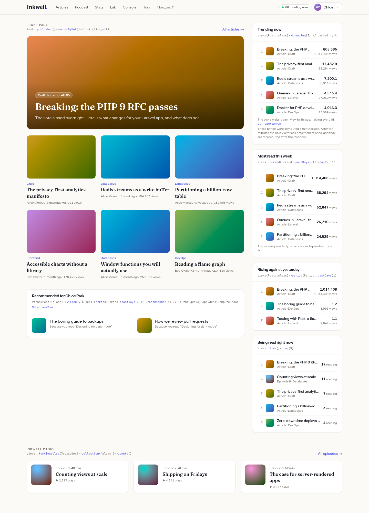
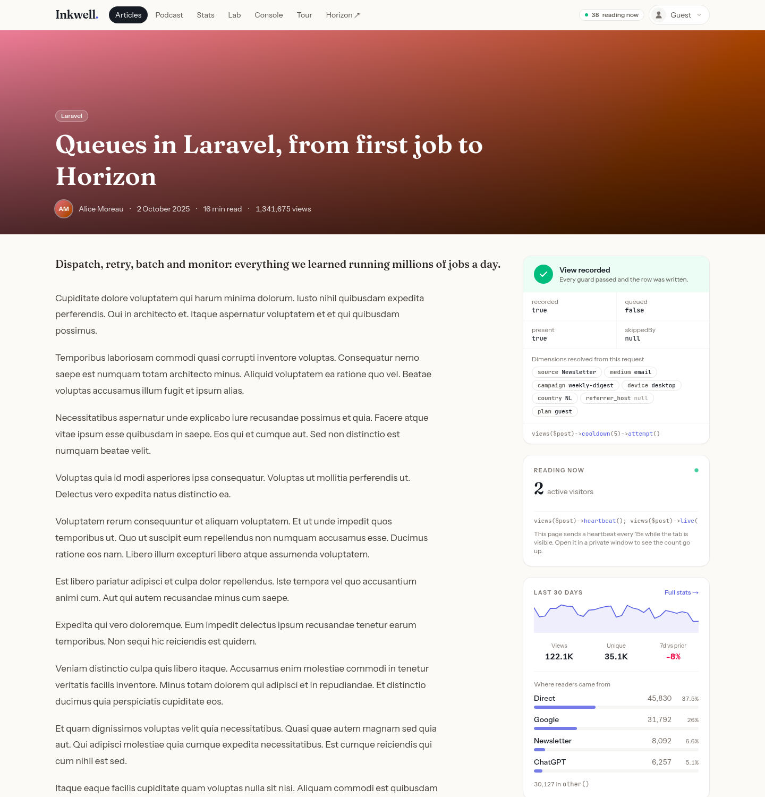
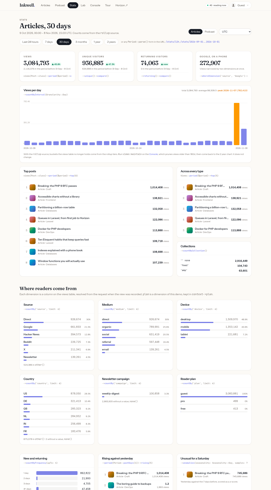
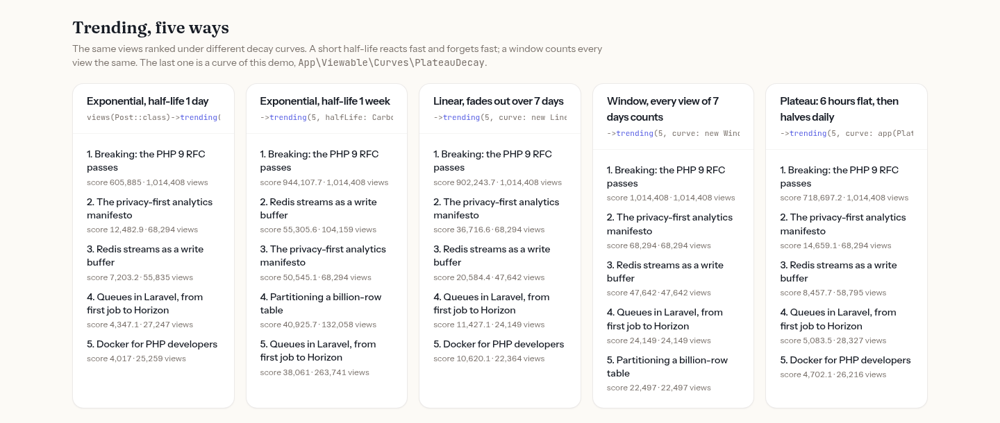
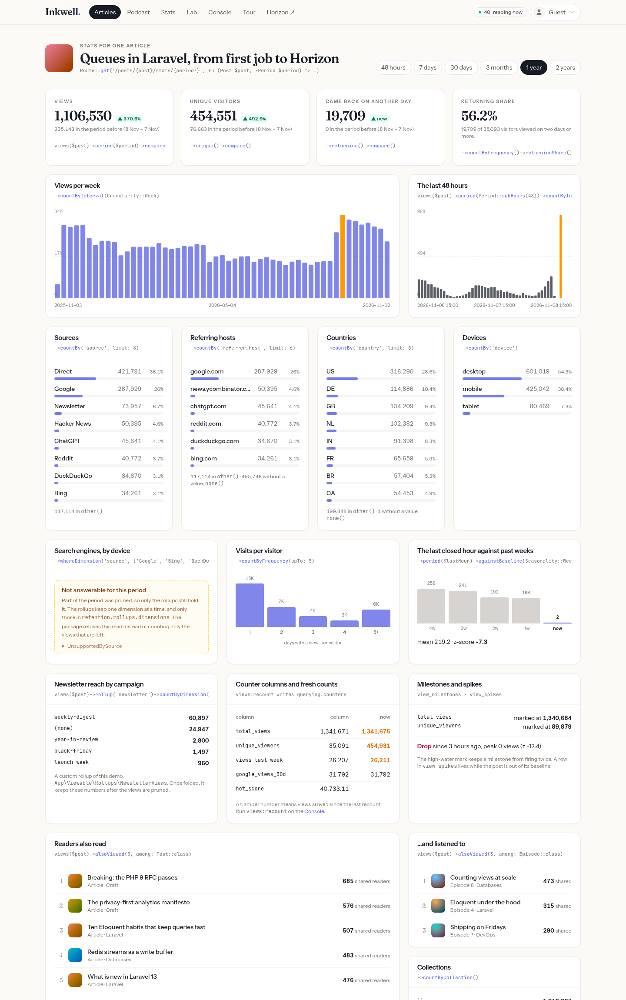
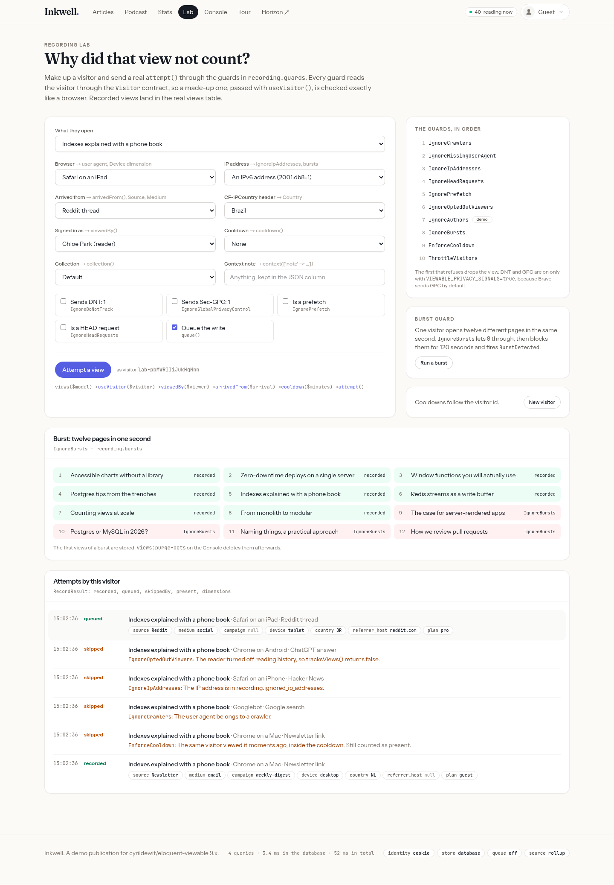
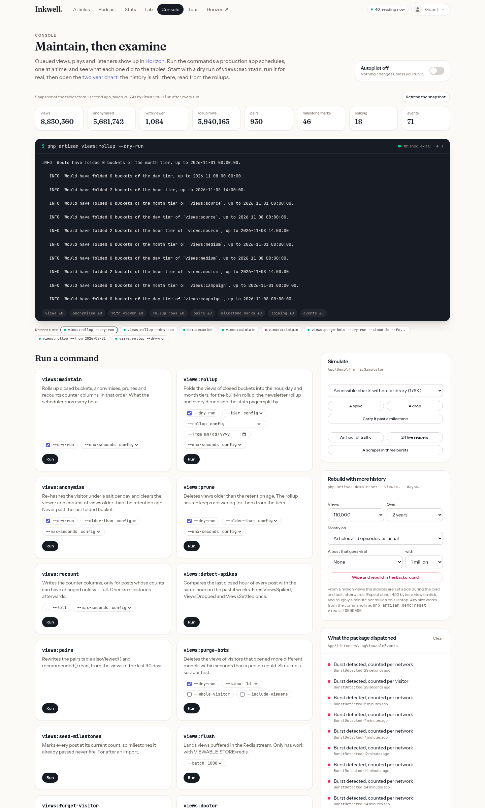
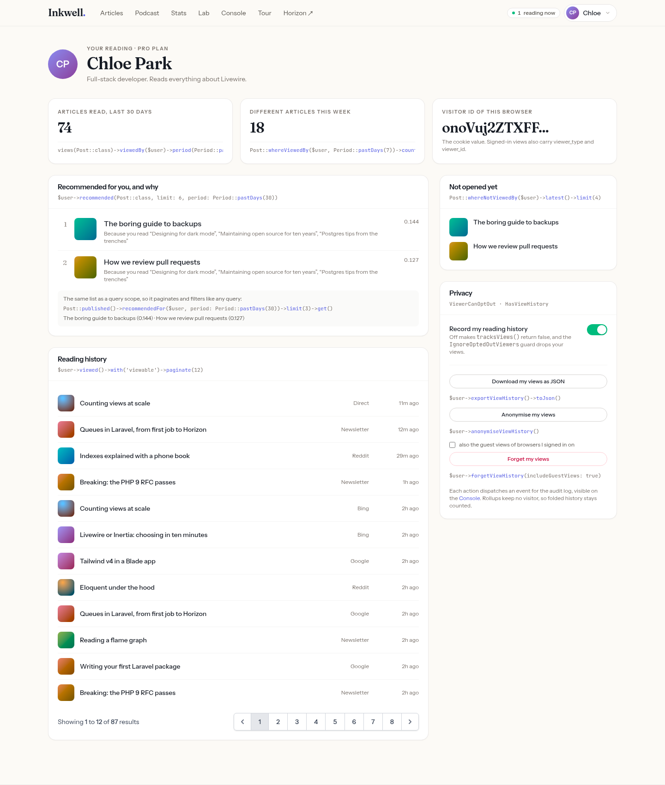
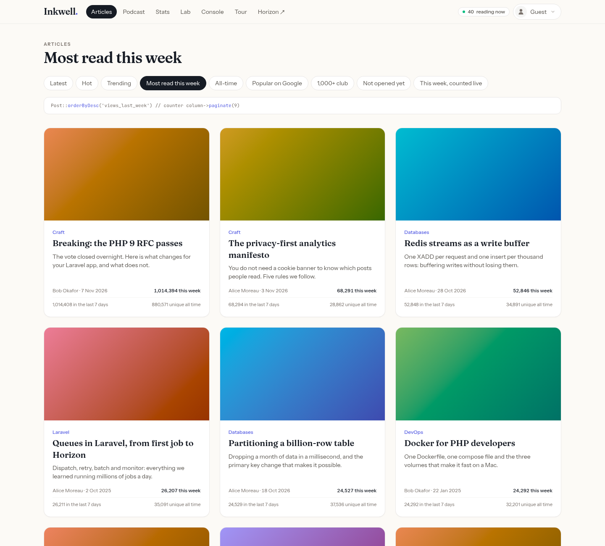
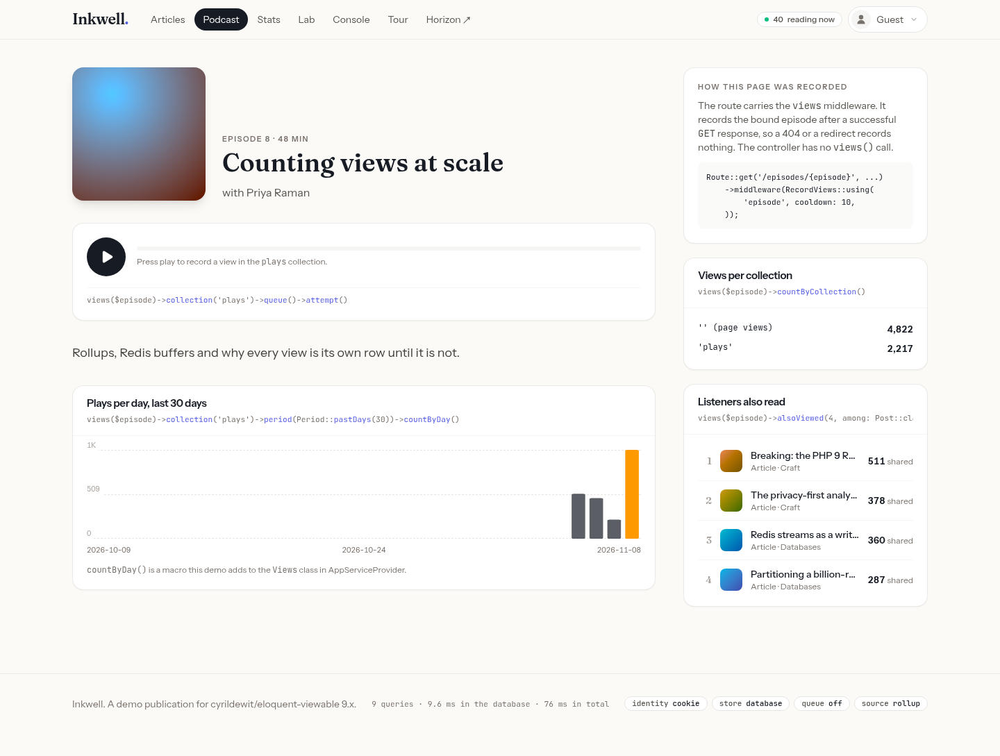

# Inkwell, the Eloquent Viewable 9.x demo

Inkwell is a small tech publication built to explore every feature of
[cyrildewit/eloquent-viewable](https://github.com/cyrildewit/eloquent-viewable) 9.x locally. It ships with two years
of simulated traffic, about 110,000 views of 24 articles and 8 podcast episodes by 25 readers. Every panel in the app
names the package call it makes.

The app runs Laravel 13 on PHP 8.5 and requires the package from a local checkout of the unreleased `9.x` branch, so a
change to the package shows up in the demo on the next request.

## Screenshots

**Front page.** A hot score from a counter column, trending, most read across types, rising, readers right now, and
recommendations with the reason for each.



**An article.** The receipt of `attempt()`: recorded or skipped, by which guard, and the dimensions resolved from the
request. Next to it, readers right now from a heartbeat, the last 30 days and where readers came from.



**Stats.** Views, unique and returning visitors compared with the period before, a chart per interval, rankings across
types, and a split by every dimension, all from a `Period` in the URL.



**Trending, five ways.** The same views ranked under exponential, linear, window and a custom decay curve.



**One article's stats.** Weekly and hourly series, sources, referring hosts, countries and devices, visits per visitor,
the last hour against past weeks, a custom rollup per newsletter campaign, counter columns next to fresh counts, and
milestone and spike state.



**Recording lab.** A made-up visitor sent through every guard: crawlers, ignored addresses, opted-out readers, cooldowns
and a burst, each with the reason it was refused.



**Console.** The maintenance commands, run in the background with their output and a diff of the tables, next to the
simulations and the events the package dispatched.



**A reader's account.** Reading history, recommendations as a list and as a query scope, unread articles, and the
opt-out, export, anonymise and forget controls.



**Article lists.** Each sort is a scope or a counter column.



**A podcast episode.** Recorded by the route middleware, with plays in their own collection, written through the queue.



The screenshots come from `scripts/screenshots/capture.mjs`, which drives headless Chromium against the running demo.

## Getting started

Clone the package next to this app and check out `9.x`:

```bash
git clone https://github.com/cyrildewit/eloquent-viewable.git ../eloquent-viewable
git -C ../eloquent-viewable checkout 9.x
```

Then build and seed everything:

```bash
./setup.sh
```

`setup.sh` starts the containers, installs Composer and npm packages, builds the frontend and runs `demo:reset`. It
expects an external `traefik-gateway` network with Traefik serving `*.localhost`, and opens on
<https://eloquent-viewable-demo.localhost/tour>.

| Container       | Runs                                                                       |
|-----------------|----------------------------------------------------------------------------|
| `evd-php`       | PHP-FPM, Composer and Node                                                 |
| `evd-horizon`   | Laravel Horizon: queued views and episode plays, dashboard at `/horizon`   |
| `evd-scheduler` | `schedule:work`: `views:maintain`, `views:detect-spikes`, `views:pairs`, `views:flush` |
| `evd-nginx`     | The web server behind Traefik                                              |
| `evd-mariadb`   | The database                                                               |
| `evd-redis`     | Cache, sessions, queue, cooldowns, presence and the optional view buffer   |

The containers get their database, Redis and mail settings from `docker-compose.yml`, so `.env` only needs an
`APP_KEY`. The `../eloquent-viewable` checkout is mounted into the PHP containers, and Composer symlinks it into
`vendor/` through the path repository in `composer.json`.

Rebuild the data at any time, from the Console page or the command line:

```bash
docker exec evd-php php artisan demo:reset                    # two years, about 110,000 views
docker exec evd-php php artisan demo:reset --views=1000000    # a million views
```

## Millions of views

`demo:reset` takes the size of the history as options, so a table of 20 million views is one command:

```bash
docker exec -it evd-php php artisan demo:reset \
    --views=20000000 \
    --days=1095 \
    --focus=post \
    --viral=breaking-the-php-9-rfc-passes:1000000
```

| Option          | Default   | Effect                                                                        |
|-----------------|-----------|-------------------------------------------------------------------------------|
| `--views`       | `110000`  | How many views to simulate                                                    |
| `--days`        | `730`     | Over how many days, ending now. Days before the oldest article get no share   |
| `--focus`       |           | `post` or `episode`, to put nearly all views on one type                      |
| `--viral`       |           | `slug:views`, a post that goes viral, repeatable                              |
| `--bulk`        | from 1M   | Drop the views indexes during the load and build them afterwards              |
| `--no-bulk`     |           | Keep the indexes up to date during the load                                   |
| `--skip-derived`|           | Skip `views:pairs` and `views:recount` afterwards                             |
| `--force`       |           | Do not ask before a load of more than five million views                      |

The command prints a size estimate before it starts and the time of every step at the end. Expect about 450 bytes
a view on disk with the demo's indexes, so 20 million views take about 9 GB in the MariaDB volume.

The Console's "Rebuild with more history" form runs the same command in the background, up to 20 million views.

**After a large load,** run `views:maintain` from the Console. Its first run folds every day into the rollups and
prunes views older than 180 days, which takes a while on millions of rows. Pick a `--max-seconds` to spread it over
several runs. Until then, every count over a long period reads the whole views table.

**Every page shows its cost** in the footer: the number of queries, the time the database spent on them and the
time of the whole request. Compare a page before and after `views:maintain`, and on a cold and a warm cache. Debugbar
records every query with a backtrace, which adds to those numbers; set `DEBUGBAR_ENABLED=false` in `.env` for honest
timings, and the footer says when it is collecting.

### Tuned for large tables

The demo runs the setup the package recommends once the views table holds millions of rows:

- **Every dimension the stats pages split by is folded** into the rollups, so a count by source, medium, campaign,
  device, country, referrer host or plan reads a few rollup rows per day instead of every view.
- **The hour tier** folds closed hours for 35 days, so trending, rising, the spike baselines and today's closed hours
  come from the rollups too. Only the current hour reads the views table.
- **List sorts use counter columns.** "Most read this week", "Popular on Google" and "1,000+ club" sort on
  `views_last_week`, `google_views_30d` and `total_views`, which `views:recount` writes. "This week, counted live" runs
  `orderByViews()` on every request instead, for comparison.
- **Repeated reads are remembered,** in minutes: `remember(10)` for a guest's recommendations on the account page, `remember(1)`
  for an article's view count, 15 minutes for the Stats page.
- **The front page never waits.** Its shared panels are served stale for up to an hour while they recompute after
  the response, through `Cache::flexible()`. Recommendations are worked out in the queue by
  `App\Jobs\ComputeRecommendations`: a reader's first visit shows what is trending, the next one their list, and a
  stale list is shown while it refreshes.
- **The Stats page is computed ahead of its visitors.** `demo:warm` runs every five minutes from the scheduler and
  fills the cache for every period the page links to. It stands aside while a Console command or the package's
  maintenance lock is active, and on a large table with nothing folded yet: there every read scans the views table,
  each fold step forgets the answers again, and warming only slows the fold down.
- **MariaDB gets a 4 GB buffer pool,** set with `MARIADB_BUFFER_POOL` in `docker-compose.yml`. The default 128 MB
  cannot hold the indexes of a table this size, so most reads would come from disk.

Unique visitors, new and returning visitors, and counts that combine two dimensions still read the views table: rollups
cannot add up visitors across buckets exactly, and keep one dimension at a time.

### The Console at scale

Commands from the Console run in the background, so a run of minutes never hits a web server timeout. The run panel
streams the output as it is written, and recent runs stay one click away. Each run is a few files under
`storage/app/console-runs`.

The figures on the Console come from a snapshot that `demo:examine` takes after every run, because counting tens of
millions of rows takes seconds. "Refresh the snapshot" takes a new one.

## Performance at 21 million views

Measured on this demo with 21 million views over three years, on a laptop: Docker, one MariaDB 11.8 with a 4 GB buffer
pool. Reads are timed without `remember()`, so every number is what an uncached request pays.

**Reads**, before and after the first `views:maintain` folded the rollups and pruned views older than 180 days:

| Read                                       | Raw views table | With rollups |
|--------------------------------------------|----------------:|-------------:|
| One post, all-time count                   | 103 ms          | 3.5 ms       |
| One post, 2 years by month                 | 599 ms          | 17 ms        |
| One post, views by source over a year      | 1.8 s           | 4 ms         |
| All posts, 2 years by month                | 16 s            | 0.6 s        |
| All posts, views by source over a year     | 23 s            | 0.2 s        |
| Top 10 and trending                        | 1.6–2.4 s       | 0.12–0.15 s  |
| Unique visitors of all posts, 30 days      | 4.3 s           | 2.9 s        |
| `orderByViews()` and `whereViewsCount()`   | 1.8 s           | 0.8 s        |
| `recommended()` over 30 days               | 19 s            | 20 s         |

Every count that does not depend on visitors came out identical after 12 million views were pruned. Unique visitors,
returning visitors, counts that combine two dimensions, the view scopes and recommendations read the views table by
design; cache them, or compute them in a scheduled job.

**Pages**, with the demo's caching and the Stats page warmed by `demo:warm`:

| Page                 | Cold   | Warm    |
|----------------------|-------:|--------:|
| Front page           | 0.18 s | 0.04 s  |
| An article           | 0.12 s | 0.03 s  |
| Stats for 7 days     | 8.5 s  | 0.07 s  |

**Recording and upkeep:**

| Work                                                    | Time                        |
|---------------------------------------------------------|-----------------------------|
| Record a view, during the request or queued             | 1.7–2.2 ms                  |
| 50 views a second through the queue, three workers      | no backlog, no failed jobs  |
| First `views:maintain` over 21 million views            | 2 h                         |
| Hourly `views:maintain` after that                      | 23 s                        |
| `views:pairs`, from 90 days of views                    | 53 s                        |
| `views:detect-spikes`                                   | under 1 s                   |

**Storage:** 411 bytes a view with the demo's indexes. After pruning, 8.8 million views remain, next to 3.9 million
rollup rows taking about 900 MB, two thirds of them in the hour tier of the dimension rollups. Deleting views does not
shrink an InnoDB table; reclaim the space with `OPTIMIZE TABLE` or by partitioning.

Run the same measurements on your own data, and compare two runs, with:

```bash
docker exec evd-php php artisan demo:benchmark before
docker exec evd-php php artisan demo:benchmark after --compare=before
```

## Simulating traffic through the package

`demo:reset` writes rows straight into the views table: fast, but it skips the guards, the dimension resolver, presence,
the queue and the Redis buffer. `demo:traffic` sends made-up visitors through `views($model)->attempt()` instead, so
every view takes the path a real one would.

```bash
# Live: 50 attempts a second for 30 minutes, every guard and presence on
docker exec -it evd-php php artisan demo:traffic live --rate=50 --duration=30m

# The same, with every view handed to Horizon (watch /horizon)
docker exec -it evd-php php artisan demo:traffic live --rate=50 --duration=30m --via=queue

# Replay: fill the last 90 days with 200,000 views, as fast as they record
docker exec -it evd-php php artisan demo:traffic replay --days=90 --views=200000

# Replay through the queue, pausing while more than 5,000 jobs wait
docker exec -it evd-php php artisan demo:traffic replay --days=30 --views=50000 --via=queue

# Replay into the Redis buffer for this run only; it flushes its own stream at the end
docker exec -it evd-php php artisan demo:traffic replay --days=7 --views=20000 --store=redis
```

- **Live** records in real time. A visit's later pages come minutes later, as they would, and new visits top each second
  up to `--rate`. Cooldowns, the burst guard and the throttle keep working, and presence shows the readers.
- **Replay** moves the clock with `Carbon::setTestNow()` before each attempt. The recorder stamps the view then, and the
  queue job and the Redis stream carry that time. Guards that keep state in the cache would trip on years squeezed into
  minutes, so the run turns off `EnforceCooldown`, `IgnoreBursts`, `ThrottleVisitors` and presence. It starts no
  earlier than the prune watermark, because the rollup source reads pruned ranges from the tiers.
- **Afterwards**, run `views:rollup` or `views:maintain` so already folded buckets pick up the late views, then
  `views:recount` and `views:pairs`.
- **For the full Redis setup**, set `VIEWABLE_STORE=redis` in `.env` and restart. The scheduler then flushes every
  minute, and the Console and `views:doctor` show how long buffered views wait.

The visitors get one stable address each in `100.64.0.0/10` and a user agent that matches their device, so the
Device dimension and the burst guard's network count behave as they would with real readers. Ctrl+C stops a run and
prints the tally: recorded, queued, and skipped per guard.

## A tour

Start at **/tour**: it lists every feature with a link to where the demo shows it. The main pages:

- **Front page (/).** Hot posts from a counter column, trending, most read across types, rising, live readers and
  recommendations with the reason for each.
- **Articles (/posts).** Each sort tab is a scope: `orderByHot()`, `orderByTrending()`, `orderByViews()` with a
  period or a dimension, `whereViewsCount()` and `whereNotViewedBy()`.
- **An article.** It records with `attempt()` and shows the receipt: recorded or skipped, by which guard, and the
  dimensions resolved from the request. It also has a live reader count with its own heartbeat, a 30-day sparkline,
  sources and "readers also read".
- **The lite edition (/lite/{post}).** The same article from a full-page cache, recorded by `@viewsBeacon` with a
  live counter.
- **Podcast (/episodes).** Recorded by the `views` route middleware. Plays go to the `plays` collection through the
  queue.
- **Stats (/stats/{period}).** The period binds from the URL (`/stats/7d`, `/stats/12h`,
  `/stats/2026-01-01..2026-02-01`). The page has comparisons, charts per hour, day, week or month in any timezone,
  dimension splits, new and returning visitors, rising items, spikes and drops, five trending curves and live
  presence.
- **Per-post stats (/posts/{post}/stats/{period}).** A baseline against past weeks, the custom newsletter rollup,
  counter columns next to fresh counts, and milestone and spike state.
- **Lab (/lab).** Make up a visitor, with any browser, IP, referrer, UTM tags, country, reader, cooldown,
  prefetch, `HEAD`, DNT or GPC. It sends a real `attempt()` through every guard. A burst button shows `IgnoreBursts`
  at work.
- **Console (/console).** Run every `views:*` command with its options and see a before-and-after diff of the
  tables. Examine the views table, the rollup tiers, the watermarks, pairs, milestones, spikes and counter columns,
  and follow the feed of events the package dispatched. Simulate a spike, a drop, a milestone, a scraper or live
  readers.
- **Account (/account).** Switch readers from the menu at the top right. This page shows reading history,
  recommendations and the `recommendedFor()` scope, the opt-out switch, and export, anonymise and forget.

### Things to try

1. On the Console, run `views:maintain` with `--dry-run`, then for real. Watch the "Where each month of history lives"
   chart: the rollup tiers appear and raw rows older than 180 days are pruned. The two-year chart on Stats stays the
   same, because the `rollup` source adds the parts up.
2. Simulate a spike on a post, run `views:detect-spikes`, and read `ViewsSpiked` in the event feed. Do the same with
   a drop.
3. Carry a post past a milestone, run `views:recount`, and read `ViewMilestoneReached`.
4. Simulate a scraper, then run `views:purge-bots --dry-run`, and then run it with `--whole-visitor`.
5. Sign in as Alice and open one of her posts. The demo's own `IgnoreAuthors` guard skips the view. Sign in as Dan
   and every view is skipped, because he opted out.
6. Open an article in two browsers and watch "Reading now".
7. Turn on the autopilot on the Console. The scheduler container then maintains the data every hour and adds a trickle
   of readers every minute.

## Switches

Set these in `.env`, then restart with `docker compose restart php horizon scheduler`. The Console shows the values in
use.

| Variable                   | Default  | Effect                                                                     |
|----------------------------|----------|----------------------------------------------------------------------------|
| `VIEWABLE_IDENTITY`        | `cookie` | `viewer` counts accounts, `fingerprint` counts without a cookie            |
| `VIEWABLE_STORE`           | `database` | `redis` buffers views in a stream until `views:flush`                    |
| `VIEWABLE_QUEUE`           | `false`  | `true` hands every insert to Horizon                                       |
| `VIEWABLE_SOURCE`          | `rollup` | `database` reads only the views table                                      |
| `VIEWABLE_PAIRS`           | `true`   | `false` makes `alsoViewed()` and `recommended()` read the views table      |
| `VIEWABLE_HOUR_TIER`       | `true`   | `false` drops the 35-day hour tier that answers trending, rising and spikes |
| `VIEWABLE_PRIVACY_SIGNALS` | `false`  | `true` honours `DNT` and `Sec-GPC`, which Brave sends by default           |

## What the demo configures

`config/eloquent-viewable.php` is the 9.x config with these changes:

- **Recording.** The viewer is recorded, the beacon is on and cooldowns live in Redis. `ThrottleVisitors` is on, and
  so is a guard of the demo, `App\Viewable\Guards\IgnoreAuthors`. Views from `198.51.100.0/24` are ignored.
- **Dimensions.** Every built-in dimension is recorded, plus `plan`, a dimension of the demo kept in
  `context->plan`. Country falls back to the `Accept-Language` region through
  `App\Viewable\Dimensions\AcceptLanguageCountry`.
- **Counter columns.** Posts keep `total_views`, `unique_viewers`, `views_last_week`, `google_views_30d` and a
  `hot_score`. Episodes keep `total_views` and `plays`.
- **Retention.** Views are anonymised after 30 days and pruned after 180. Rollups keep a day tier for two years and
  a month tier forever, with source, device and country folded per value, and a custom rollup,
  `App\Viewable\Rollups\NewsletterViews`.
- **Milestones, spikes, pairs and presence** are all on, with low thresholds so the simulated traffic crosses them.
- **Extensions.** The demo adds a trending curve, `App\Viewable\Curves\PlateauDecay`, a doctor check,
  `App\Viewable\Doctor\QueueBacklogCheck`, and a `countByDay()` macro on `Views`.

The simulated traffic comes from `App\Demo\TrafficSimulator`. It writes rows the way the package would record them:
visits of one to four related pieces, a daily and weekly rhythm, a head start for new posts, and sources that shift
over time.

## Tests

```bash
docker exec evd-php php artisan test
```

The tests seed a small history into an in-memory SQLite database. `phpunit.xml` forces that database in `$_SERVER`,
because Docker sets `DB_CONNECTION=mysql` as a real environment variable, and `tests/TestCase.php` refuses to run
against anything else.
